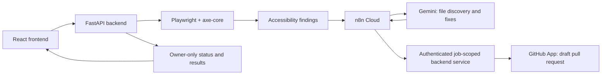

# AccessPilot

**Find accessibility issues. Propose source-code fixes. Review them in a draft pull request.**

AccessPilot connects a React frontend, an axe-core browser scanner, and an AI remediation workflow. Sign in with GitHub, choose an authorized repository, and submit its deployed website. The backend scans the page, sends the findings to n8n Cloud, and provides job-scoped access to the repository's pinned source. Two Gemini agents identify relevant files and propose fixes; the backend validates the changes and creates a draft PR for human review.

This is a local-development prototype. Automated checks use mocked integrations; they do not establish that your GitHub, Windows browser, n8n, Gemini, or tunnel configuration works. Follow the [manual end-to-end checklist](LOCAL_E2E_TEST.md) to verify your setup.

## Features

- GitHub App OAuth with HTTP-only sessions and CSRF protection.
- Searchable selection of repositories authorized for both the user and App installation.
- Asynchronous Playwright + axe-core scanning with timeouts, concurrency limits, and public-network restrictions.
- Actual accessibility findings: violation IDs, impact, descriptions, selectors, and affected-element evidence.
- Separate scan and remediation states, with confirmed draft PR links on the results page.
- Dark code-review workspace with owner-authorized, pinned-commit diffs, line numbers, and green/red additions and deletions.
- Job-scoped source retrieval and bounded remediation writes for n8n.
- One remediation branch and commit per audit; no direct writes to the default branch.
- Responsive frontend with interactive feature cards and pause/spin controls.

Automated accessibility testing cannot establish full WCAG compliance. Review proposed code and perform manual accessibility checks before merging.

## How it works



GitHub credentials and installation tokens stay on the backend. n8n receives a separate expiring per-job credential. It must not send that credential to Gemini or expose it to the browser.

## Stack

| Component | Technology |
| --- | --- |
| Frontend | React, TypeScript, Vite, Tailwind CSS |
| Backend | Python 3.12+, FastAPI, httpx |
| GitHub authentication | GitHub App, PyJWT, cryptography |
| Scanner | Playwright Chromium, axe-core via axe-playwright-python |
| AI workflow | n8n Cloud and two Gemini agents, configured separately |
| Development callbacks | Cloudflare Quick Tunnel |
| Prototype storage | Expiring in-memory sessions and jobs |

## Repository layout

```text
frontend/                 React application and frontend tests
backend/
  main.py                 Browser API, OAuth, sessions and job status
  github_auth.py          GitHub App and user authorization
  audit_jobs.py           Bounded asynchronous scan queue and n8n delivery
  scanner.py              Browser accessibility scanner
  job_sources.py          Job-scoped repository tree and source routes
  remediation.py          Validated commit and draft PR creation
  tests/                  Mocked backend tests
  .env.example            Server configuration template
  README.md               Backend API and security contracts
  SECURITY_AUDIT.md       Security controls and validation boundaries
LOCAL_E2E_TEST.md          Windows setup and manual real-data checklist
```

## Local setup — Windows PowerShell

Install Python 3.12+, a current Node.js LTS release, and npm. Install cloudflared separately if you need n8n Cloud callbacks.

From the repository root:

```powershell
python -m venv .venv
.\.venv\Scripts\python.exe -m pip install -r backend\requirements.txt
$env:PLAYWRIGHT_BROWSERS_PATH = "C:\playwright-browsers"
.\.venv\Scripts\python.exe -m playwright install chromium
if (!(Test-Path backend\.env)) { Copy-Item backend\.env.example backend\.env }
if (!(Test-Path frontend\.env)) { Copy-Item frontend\.env.example frontend\.env }
npm --prefix frontend ci
```

Edit `backend/.env` with your GitHub App ID, Client ID, Client Secret, App slug, private-key path, n8n production webhook URL, and webhook authentication secret. Use the existing GitHub App; no personal access token is needed.

Keep local origins consistent:

```dotenv
# backend/.env
FRONTEND_ORIGIN=http://localhost:3000
GITHUB_CALLBACK_URL=http://localhost:8000/auth/github/callback
COOKIE_SECURE=false
```

```dotenv
# frontend/.env — public configuration only
VITE_API_BASE_URL=http://localhost:8000
```

In GitHub App settings, configure the exact localhost callback above, grant repository **Contents: read/write** and **Pull requests: read/write**, and install the App on the intended repository. Approve installation permission updates if necessary. The signed-in user also needs push permission for remediation.

Never commit `.env`, private keys, or tokens. Frontend `VITE_` variables are public and must never contain secrets.

### Start the application

Backend, in one PowerShell terminal:

```powershell
$env:PLAYWRIGHT_BROWSERS_PATH = "C:\playwright-browsers"
.\.venv\Scripts\python.exe -m backend.run --tunnel
```

Frontend, in another:

```powershell
npm --prefix frontend run dev
```

Open **http://localhost:3000**. Click **Start a scan** to open the connection panel;
only **Connect my GitHub** redirects to GitHub. After authorization you return to
the dashboard. Existing sessions show the connected account, Continue, and Disconnect. The API listens on port 8000. Use `localhost` consistently for browser requests and OAuth; `127.0.0.1` is a different cookie host.

Use one backend process, without reload or multiple workers. For Linux/macOS setup and scanner platform details, see [backend/README.md](backend/README.md).

### Connect n8n Cloud

n8n Cloud cannot call your local machine's localhost. When ready for manual testing, start a separate terminal:

```powershell
cloudflared tunnel --url http://127.0.0.1:8000
```

Update the trusted HTTPS backend base URL used by n8n's **tree, source, and remediation** HTTP nodes every time the Quick Tunnel hostname changes. Keep the frontend API URL and GitHub OAuth callback on localhost. The backend's `N8N_WEBHOOK_URL` is the outbound n8n webhook, not the Cloudflare URL.

All `/service/jobs/*` calls require the original webhook's per-job Bearer credential. A tunnel hostname alone is not authentication. The hardened launcher disables API docs, access logs, and proxy-header trust. Stop the tunnel after testing.

See [LOCAL_E2E_TEST.md](LOCAL_E2E_TEST.md) for the request contracts, n8n configuration, and troubleshooting.

## API overview

| Endpoint | Purpose |
| --- | --- |
| `GET /health` | Process health |
| `GET /auth/github/login` | Start GitHub OAuth |
| `GET /auth/github/me` | Current user and CSRF token |
| `GET /github/install` | Open GitHub App installation |
| `GET /github/repositories` | List authorized repositories |
| `POST /audits` | Queue an authorized accessibility audit |
| `GET /audits/{job_id}` | Owner-only scan findings and remediation status |
| `GET /audits/{job_id}/changes` | Owner-only confirmed code diff; rechecks live repository access |
| `POST /auth/logout` | End the current browser session |
| `GET /service/jobs/{job_id}/tree` | Machine-authenticated pinned source tree |
| `GET /service/jobs/{job_id}/source` | Machine-authenticated source-file retrieval |
| `POST /service/jobs/{job_id}/remediation` | Validated job-scoped changes and draft PR |

Browser requests use cookies; write requests require the session CSRF token and matching Origin. Service routes require a separate job credential and recheck authorization. Full request/response details are in the [backend documentation](backend/README.md).

## Testing

```powershell
.\.venv\Scripts\python.exe -m pytest backend\tests -q
npm --prefix frontend test
npm --prefix frontend run typecheck
npm --prefix frontend run build
```

Last local validation: **227 backend tests passed**, with **2 native-Windows tests skipped on Linux**; **50 frontend tests passed**, and the production build and TypeScript checks passed. Backend health, strict CORS, authentication rejection, and disabled documentation were checked in a local process. A Chromium journey with mocked APIs was checked at desktop and mobile widths.

Automated tests never create real GitHub commits or PRs. Live Windows Chromium scanning, OAuth consent, Cloudflare routing, and your n8n/Gemini execution still require manual verification.

## Prototype limitations

Code previews are captured for **new** remediation jobs only. Restart both services
after updating, then submit a fresh audit. No n8n workflow changes are needed.

- Sessions and jobs live in memory. Restarting the backend loses them; jobs expire within one hour or earlier with their authorization. No persistent audit history is provided.
- `submitted` means n8n accepted the audit, **not** that remediation completed. Only a confirmed backend result produces a PR link.
- There is no completion callback for n8n failures before remediation or no-change outcomes. Inspect the n8n execution if the UI keeps waiting.
- Remediation accepts a bounded changeset of existing permitted frontend files. It rejects protected paths, stale bases, empty changes, and repository overrides.
- GitHub's multi-step API is not transactional. Failures can leave a branch or unreferenced objects; ambiguous outcomes may require manual reconciliation. Idempotency applies only during the live job's lifetime.
- Generated changes need human review. Draft PR creation does not prove that a fix works or that a site is compliant.

See [the security audit](backend/SECURITY_AUDIT.md) before exposing the backend through a temporary authenticated development tunnel.
